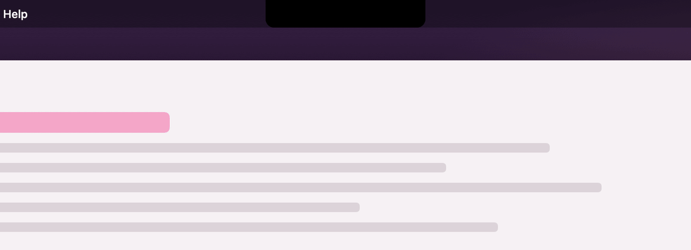
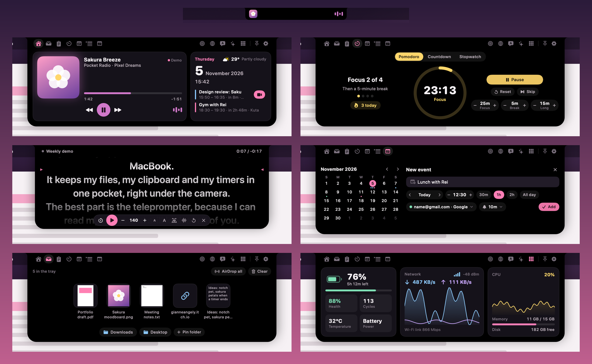

# 🌸 Saku

Saku turns the MacBook notch into **a little pocket of tools**. Hover the camera and it blooms open with your music, timers, files, clipboard, calendar, a to-do list, an AI assistant and a teleprompter that scrolls right under the lens. It's native, free, and needs no account.



**[Download Saku](https://github.com/GianneAngely/saku/releases/latest)** for macOS 26 or later, on Apple silicon and Intel Macs. Every feature is free. Website and privacy policy: [gianneangely.github.io/saku-site](https://gianneangely.github.io/saku-site/).

## Why Saku

- **Everything is free.** Music control, timers and the rest aren't behind a paid upgrade.
- **A teleprompter under the camera.** Read your script while looking at the lens; it can follow your voice and is hidden from screen sharing.
- **Your Google Calendar,** through macOS Internet Accounts. Saku never sees your Google password.
- **Your Google Tasks.** A to-do list with subtasks and due dates that syncs both ways with Google Tasks, so tasks from your phone show up in the notch.
- **Nothing to hunt for.** The grid button lists every feature and where it lives, with search in English and Bahasa Indonesia.
- **Private and light.** No account, no analytics, about 0.02% CPU and 28 MB of memory at rest.



## Install

1. Download the latest `Saku-x.y.z.zip` from [Releases](https://github.com/GianneAngely/saku/releases/latest), unzip it and drag **Saku** into **Applications**.
2. Open it. macOS says it can't check Saku for malware, because Saku isn't notarized (that needs a paid Apple developer account). Click **Done**, open **System Settings › Privacy & Security**, scroll down and click **Open Anyway** next to Saku. You only do this once.
3. Hover the notch. The welcome tour shows the basics.

If another notch app is running, quit it first so the two don't overlap.

<details>
<summary>Prefer Terminal, or building it yourself?</summary>

Remove the download quarantine instead of using Open Anyway:

```bash
xattr -dr com.apple.quarantine /Applications/Saku.app
```

Build from source with the Xcode Command Line Tools (`xcode-select --install`):

```bash
git clone https://github.com/GianneAngely/saku.git
cd saku
./build.sh --install
```

</details>

## What's inside

| | Feature | What it does |
| --- | --- | --- |
| 🎵 | **Music** | Spotify, Apple Music and browser tabs (YouTube, SoundCloud…), with covers, a seek bar and album colours |
| ✨ | **Live activities** | Music, timers, charging and your next meeting sit beside the camera while the notch is closed |
| 📥 | **Tray and AirDrop** | Drop files, links, text or images on the notch, drag them out later, or AirDrop them |
| 📋 | **Clipboard** | Searchable history with images, files and rich text, pins, and snippet collections |
| ⏱️ | **Timers** | Pomodoro with long breaks and focus hooks, countdowns with presets, a stopwatch with laps |
| 🎬 | **Teleprompter** | Your script under the camera, at your pace or following your voice, hidden from screen sharing |
| 📅 | **Calendar** | Today, a month view, reminders, new events with **+**, one-click Join, and Google Calendar |
| 📝 | **Notes** | Several notes that save as you type |
| ✅ | **To-do** | Lists, subtasks and due dates; syncs both ways with Google Tasks using your own Google client ([setup guide](docs/google-tasks-setup.en.md)) |
| 💧 | **Trackers** | Days left, habit counters and a water tracker |
| 🔋 | **System** | Battery health and cycle count, network speed, Wi-Fi, CPU and memory |
| 🌐 | **Web, Translate, AI** | A small browser, on-device translation, and Apple Intelligence (or Claude and Gemini with your own key) |
| 🪞 | **Mirror** | A camera mirror with a ring light |
| 🚀 | **Apps and Shortcuts** | Launch pinned apps and run your Apple Shortcuts |
| 🧮 | **Tools** | A calculator that converts units, a colour picker, text from images, weather and 20-20-20 eye breaks |

The whole app speaks English and Bahasa Indonesia. Every feature and exactly where it lives: [docs/FEATURES.md](docs/FEATURES.md).

## Shortcuts

| Keys | Action |
| --- | --- |
| `⌃⌥Space` | Open or close Saku |
| `⌃⌥/` | All features: find anything |
| `⌃⌥V` | Clipboard, with the cursor in the search field |
| `⌃⌥B` | Tray |
| `⌃⌥A` | AI assistant |
| `⌃⌥L` | Apps |
| `⌃⌥O` | Start or pause the Pomodoro |
| `⌃⌥P` | Teleprompter: start, play or pause |
| `⌃⌥]` `⌃⌥[` `⌃⌥;` | Teleprompter faster, slower, back 5 seconds (while reading) |

Every action can get its own keys in Settings › Keyboard.

## Permissions, and why

Saku never asks at launch. Each prompt appears the first time you use the feature that needs it, and you can say no.

| Permission | Asked when | Why |
| --- | --- | --- |
| Automation: Spotify, Music | You press **Enable controls** on the music card | Read the song and control the player |
| Automation: Chrome, Safari | Only if you turn on browser music | Read and control the tab that's playing |
| Calendars | Calendar tab › Allow access | Your events, the meeting countdown, new events, Google Calendar |
| Reminders | Calendar tab › Reminders | Your reminder lists |
| Camera | Mirror tab › Start mirror | The mirror |
| Microphone and Speech Recognition | Teleprompter › Voice follow | Following your voice, on device |
| Accessibility (optional) | Clipboard › paste into the app you're using | Pressing ⌘V for you |

## Privacy

- No account, no analytics, no tracking. Your notes, clipboard and settings stay in `~/Library/Application Support/Saku` and the app's preferences.
- Saku only goes online for things you can see: the weather for the city you pick ([Open-Meteo](https://open-meteo.com)), album covers (Spotify's public oEmbed and the iTunes Search API), the Web tab, and Translate or AI when you choose a cloud service with your own key. Those requests go straight to that service.
- API keys live in the macOS Keychain.
- Google Calendar is synced by macOS itself. Saku reads and writes it through the calendar on your Mac.
- Google Tasks sync uses your own Google OAuth client and asks only for your tasks. Its token stays in the Keychain.
- The teleprompter is always hidden from screen sharing and screenshots; the whole notch can be too (Settings › General).

The full [privacy policy](https://gianneangely.github.io/saku-site/privacy.html) covers every detail, including how Saku uses Google Tasks data.

## FAQ

<details>
<summary><b>Is it really free?</b></summary>

Yes. Every feature, no trial, no account.
</details>

<details>
<summary><b>Why does macOS say it can't check Saku for malware?</b></summary>

Saku is signed but not notarized by Apple, which needs a paid developer account. Use **Open Anyway** once (see Install), or build it yourself from this repository.
</details>

<details>
<summary><b>Does it work on a Mac without a notch?</b></summary>

Yes. Saku puts an invisible notch at the top centre of the screen and opens when you hover there. You can also make it visible or turn it off (Settings › General).
</details>

<details>
<summary><b>I can't find battery health, the water tracker…</b></summary>

Click the grid button in the notch (or press `⌃⌥/`) and type what you're looking for. Battery health and cycles are in the System tab; the water tracker is in Trackers. Hover any tab icon to see its name.
</details>

<details>
<summary><b>How do I connect Google Calendar?</b></summary>

Settings › Calendar › **Connect Google Calendar**. macOS opens Internet Accounts: add your Google account there and keep Calendars on. Your Google calendars show up in Saku a moment later. Reminders can go to a Google calendar too, as short events with an alert.
</details>

<details>
<summary><b>Can the to-do list sync with Google Tasks?</b></summary>

Yes. Create your own free OAuth client in Google Cloud (about 10 minutes, once), import its JSON in Settings › To-do and sign in. The step-by-step guide is in [docs/google-tasks-setup.en.md](docs/google-tasks-setup.en.md), also in [Bahasa Indonesia](docs/google-tasks-setup.md). While your Google Cloud app is in Testing, Google asks you to sign in again every 7 days; publishing it removes that, and the guide explains both. Without a client, To-do keeps your tasks on this Mac.
</details>

<details>
<summary><b>Spotify doesn't show up.</b></summary>

Play something in Spotify, then press **Enable controls** on the music card: macOS asks once whether Saku may control Spotify. If you said no before, turn it on in System Settings › Privacy & Security › Automation.
</details>

<details>
<summary><b>Can I use it with another notch app?</b></summary>

Two notch apps fight over the same space, so quit the other one while you use Saku.
</details>

<details>
<summary><b>How do I uninstall it?</b></summary>

Quit Saku from its menu bar icon (the little blossom), then move it to the Trash. To remove its data too, delete `~/Library/Application Support/Saku`.
</details>

## Develop

```bash
swift build
.build/debug/Saku --selftest      # 470+ logic checks: silent, no windows, scratch data
.build/debug/Saku --livetest      # a few seconds of the real notch panel with a simulated pointer
.build/debug/Saku --render out/   # every state as a 2x PNG, offscreen
python3 tools/make-previews.py out/
```

[CONTRIBUTING.md](CONTRIBUTING.md) explains the layout of the code and how to send a change. `docs/` has the [features](docs/FEATURES.md), the [design](docs/DESIGN.md) and the [QA notes](docs/QA.md); HD pictures of every state are in `previews/`.

## Built with

Swift · SwiftUI · AppKit · Core Animation · EventKit · Translation · Foundation Models · Vision · Speech

No third-party packages and no Xcode project: it builds with SwiftPM and the Command Line Tools.

## License

Saku is free and open source under the [MIT License](LICENSE).
