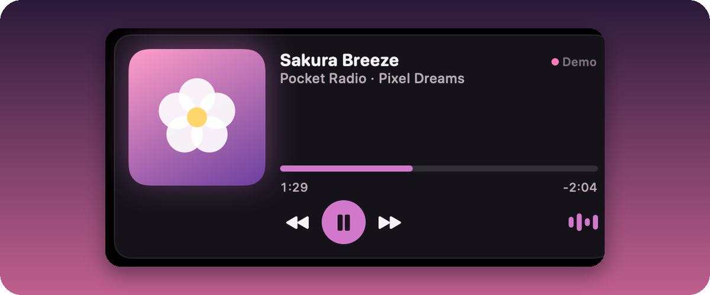
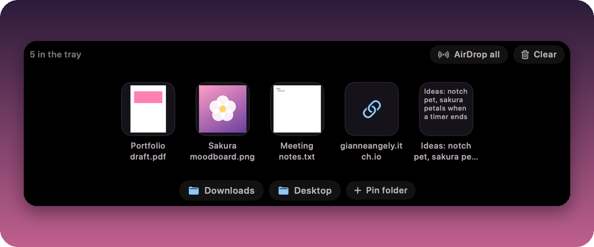
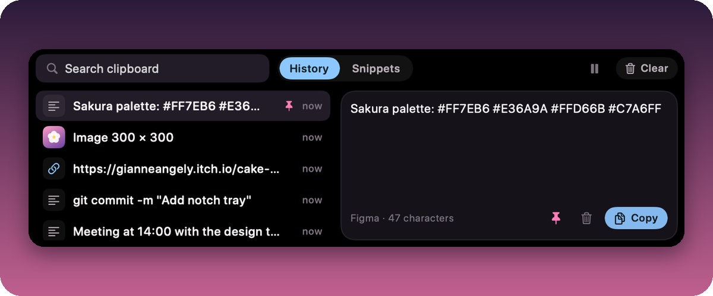
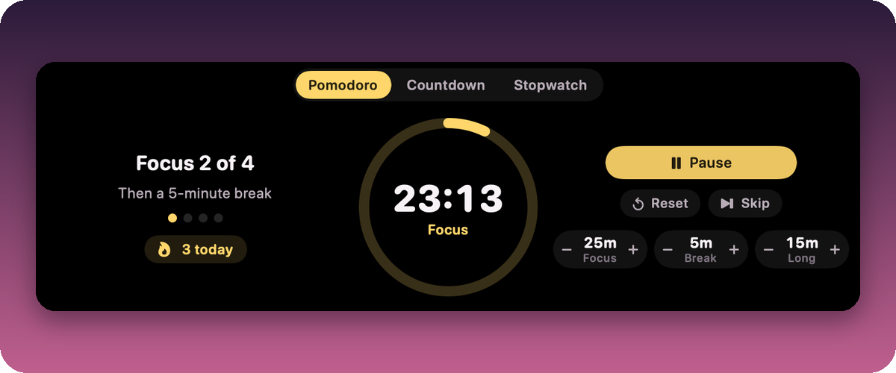
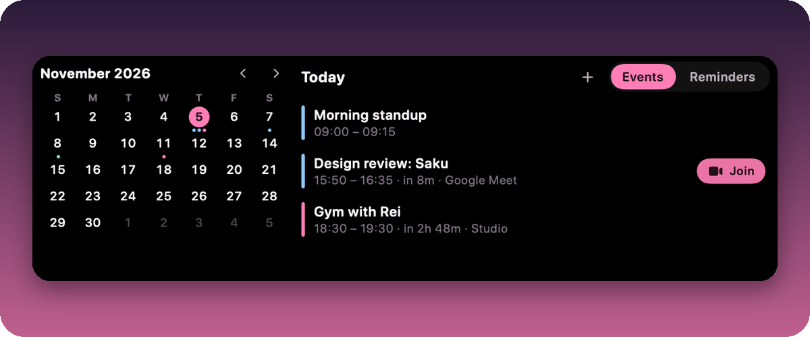
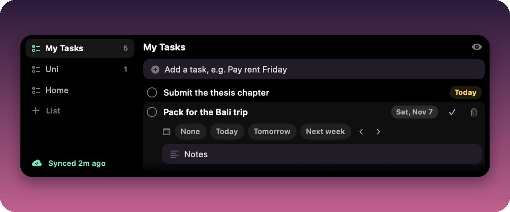
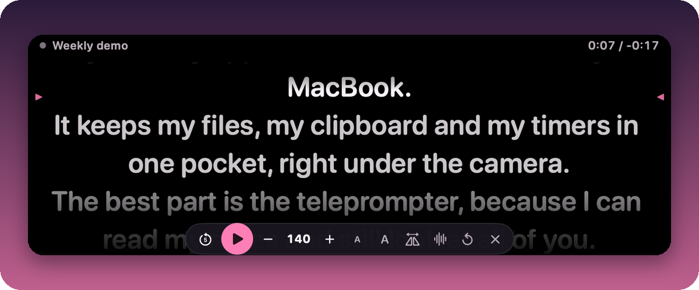
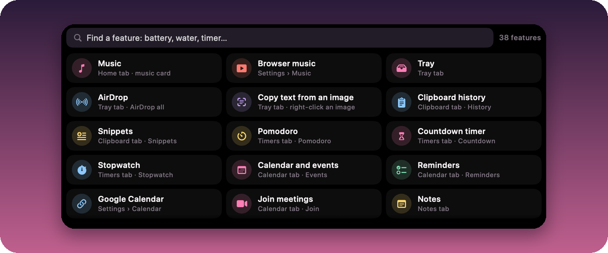

<div align="center">
  
  <h1>Saku</h1>
  <p><b>A free pocket of tools in your MacBook's notch.</b><br>
  Hover the camera and Saku opens with your music, files, clipboard, timers, calendar, to-dos and a teleprompter that scrolls right under the lens.</p>
  <p><a href="https://github.com/GianneAngely/saku/releases/latest"></a></p>
  <p>Free and open source · macOS 26 or later · Apple silicon and Intel<br>
  <a href="https://gianneangely.github.io/saku-site/">Website</a> · <a href="https://gianneangely.github.io/saku-site/privacy.html">Privacy policy</a> · <a href="CHANGELOG.md">What's new</a></p>
</div>

## What's inside

<table>
  <tr>
    <td width="50%" valign="top">
      
      <b>Music</b><br>
      Spotify, Apple Music and browser tabs like YouTube, with covers, a seek bar and controls.
    </td>
    <td width="50%" valign="top">
      
      <b>Files and AirDrop</b><br>
      Drop files, links or text on the notch, drag them out later, or AirDrop them all at once.
    </td>
  </tr>
  <tr>
    <td width="50%" valign="top">
      
      <b>Clipboard</b><br>
      Searchable history with images and files, pins and snippets. Passwords from password managers are never kept.
    </td>
    <td width="50%" valign="top">
      
      <b>Timers</b><br>
      Pomodoro with breaks, countdowns and a stopwatch, ticking beside the camera while the notch is closed.
    </td>
  </tr>
  <tr>
    <td width="50%" valign="top">
      
      <b>Calendar</b><br>
      Today, a month view and reminders, new events in plain words, one-click Join, and your Google Calendar.
    </td>
    <td width="50%" valign="top">
      
      <b>To-do and Google Tasks</b><br>
      Lists, subtasks and due dates that sync both ways with Google Tasks, so tasks from your phone show up here.
    </td>
  </tr>
  <tr>
    <td width="50%" valign="top">
      
      <b>Teleprompter</b><br>
      Your script right under the camera. It can follow your voice and stays hidden from screen sharing.
    </td>
    <td width="50%" valign="top">
      
      <b>And everything else</b><br>
      Notes, trackers, battery health, weather, translate, AI, a mirror, apps and Shortcuts. The grid button finds any of them.
    </td>
  </tr>
</table>

Native and light: about 0.02% CPU and 28 MB of memory at rest. The whole app speaks English and Bahasa Indonesia. Every feature and exactly where it lives: [docs/FEATURES.md](docs/FEATURES.md).

## Install

1. Download the latest `Saku-x.y.z.zip` from [Releases](https://github.com/GianneAngely/saku/releases/latest), unzip it and drag **Saku** into **Applications**.
2. Open it. macOS says it can't check Saku for malware, because Saku isn't notarized (that needs a paid Apple developer account). Click **Done**, open **System Settings › Privacy & Security**, scroll down and click **Open Anyway** next to Saku. You only do this once.
3. Hover the notch. The welcome tour shows the basics.

Saku needs macOS 26 or later, on Apple silicon or Intel. It's made for MacBooks with a notch; on other Macs it adds an invisible notch at the top of the screen. If another notch app is running, quit it first so the two don't overlap.

<details>
<summary>Prefer Terminal?</summary>

Remove the download quarantine instead of using Open Anyway:

```bash
xattr -dr com.apple.quarantine /Applications/Saku.app
```

</details>

## Google Tasks

The To-do tab works on its own as a list on your Mac. To sync it both ways with Google Tasks and the Tasks app on your phone, make a free Google Cloud client once and import it in Settings › To-do. The [step-by-step guide](docs/google-tasks-setup.en.md) walks you through it, also in [Bahasa Indonesia](docs/google-tasks-setup.md).

## Privacy

- No account, no analytics, no tracking. Your notes, clipboard and settings stay on your Mac in `~/Library/Application Support/Saku`.
- Saku only goes online for things you ask for: the weather for the city you pick ([Open-Meteo](https://open-meteo.com)), album covers (Spotify's public oEmbed and the iTunes Search API), the Web tab, Google Tasks, and Translate or AI when you choose a cloud service with your own key. Those requests go straight to that service.
- API keys and the Google sign-in live in the macOS Keychain. Google Calendar is synced by macOS itself.
- The teleprompter is always hidden from screen sharing and screenshots; the whole notch can be too (Settings › General).

The full [privacy policy](https://gianneangely.github.io/saku-site/privacy.html) covers every detail, including how Saku uses Google Tasks data.

## Shortcuts and permissions

<details>
<summary>Keyboard shortcuts</summary>

| Keys | Action |
| --- | --- |
| `⌃⌥Space` | Open or close Saku |
| `⌃⌥/` | All features: find anything |
| `⌃⌥V` | Clipboard, with the cursor in the search field |
| `⌃⌥B` | Tray |
| `⌃⌥A` | AI assistant |
| `⌃⌥L` | Apps |
| `⌃⌥O` | Start or pause the Pomodoro |
| `⌃⌥P` | Teleprompter: start, play or pause |
| `⌃⌥]` `⌃⌥[` `⌃⌥;` | Teleprompter faster, slower, back 5 seconds (while reading) |

Every action can get its own keys in Settings › Keyboard.

</details>

<details>
<summary>Permissions, and why</summary>

Saku never asks at launch. Each prompt appears the first time you use the feature that needs it, and you can say no.

| Permission | Asked when | Why |
| --- | --- | --- |
| Automation: Spotify, Music | You press **Enable controls** on the music card | Read the song and control the player |
| Automation: Chrome, Safari | Only if you turn on browser music | Read and control the tab that's playing |
| Calendars | Calendar tab › Allow access | Your events, the meeting countdown, new events, Google Calendar |
| Reminders | Calendar tab › Reminders | Your reminder lists |
| Camera | Mirror tab › Start mirror | The mirror |
| Microphone and Speech Recognition | Teleprompter › Voice follow | Following your voice, on device |
| Accessibility (optional) | Clipboard › paste into the app you're using | Pressing ⌘V for you |

</details>

## FAQ

<details>
<summary><b>Is it really free?</b></summary>

Yes. Every feature, no trial, no account.
</details>

<details>
<summary><b>Why does macOS say it can't check Saku for malware?</b></summary>

Saku is signed but not notarized by Apple, which needs a paid developer account. Use **Open Anyway** once (see Install), or build it yourself from this repository.
</details>

<details>
<summary><b>Why does macOS ask for my password after an update?</b></summary>

Saku keeps your API keys and your Google sign-in in one item in the macOS Keychain. Saku is signed ad hoc rather than with a paid Apple developer certificate, so macOS treats each new version as a different app and asks once before it can read that item. Type your Mac's login password and click **Always Allow**; it won't ask again until the next update.
</details>

<details>
<summary><b>Does it work on a Mac without a notch?</b></summary>

Yes. Saku puts an invisible notch at the top centre of the screen and opens when you hover there. You can also make it visible or turn it off (Settings › General).
</details>

<details>
<summary><b>I can't find battery health, the water tracker…</b></summary>

Click the grid button in the notch (or press `⌃⌥/`) and type what you're looking for. Battery health and cycles are in the System tab; the water tracker is in Trackers. Hover any tab icon to see its name.
</details>

<details>
<summary><b>How do I connect Google Calendar?</b></summary>

Settings › Calendar › **Connect Google Calendar**. macOS opens Internet Accounts: add your Google account there and keep Calendars on. Your Google calendars show up in Saku a moment later. Reminders can go to a Google calendar too, as short events with an alert.
</details>

<details>
<summary><b>Can the to-do list sync with Google Tasks?</b></summary>

Yes. Create your own free OAuth client in Google Cloud (about 10 minutes, once), import its JSON in Settings › To-do and sign in. The step-by-step guide is in [docs/google-tasks-setup.en.md](docs/google-tasks-setup.en.md), also in [Bahasa Indonesia](docs/google-tasks-setup.md). While your Google Cloud app is in Testing, Google asks you to sign in again every 7 days; publishing it removes that, and the guide explains both. Without a client, To-do keeps your tasks on this Mac.
</details>

<details>
<summary><b>Spotify doesn't show up.</b></summary>

Play something in Spotify, then press **Enable controls** on the music card: macOS asks once whether Saku may control Spotify. If you said no before, turn it on in System Settings › Privacy & Security › Automation.
</details>

<details>
<summary><b>Can I use it with another notch app?</b></summary>

Two notch apps fight over the same space, so quit the other one while you use Saku.
</details>

<details>
<summary><b>How do I uninstall it?</b></summary>

Quit Saku from its menu bar icon (the little blossom), then move it to the Trash. To remove its data too, delete `~/Library/Application Support/Saku`.
</details>

## Build from source

With the Xcode Command Line Tools (`xcode-select --install`):

```bash
git clone https://github.com/GianneAngely/saku.git
cd saku
./build.sh --install
```

For development:

```bash
swift build
.build/debug/Saku --selftest      # 470+ logic checks: silent, no windows, scratch data
.build/debug/Saku --livetest      # a few seconds of the real notch panel with a simulated pointer
.build/debug/Saku --render out/   # every state as a 2x PNG, offscreen
python3 tools/make-previews.py out/
python3 tools/make-readme-art.py  # the README pictures, from previews/
```

[CONTRIBUTING.md](CONTRIBUTING.md) explains the layout of the code and how to send a change. `docs/` has the [features](docs/FEATURES.md), the [design](docs/DESIGN.md) and the [QA notes](docs/QA.md); HD pictures of every state are in `previews/`.

## Built with

Swift · SwiftUI · AppKit · Core Animation · EventKit · Translation · Foundation Models · Vision · Speech

No third-party packages and no Xcode project: it builds with SwiftPM and the Command Line Tools.

## License

Saku is free and open source under the [MIT License](LICENSE).
